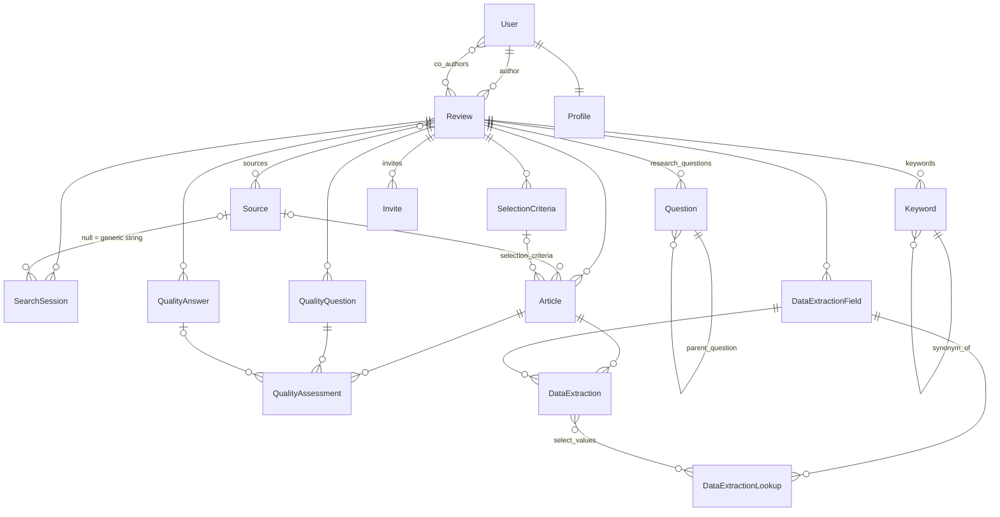

# 03 — Domain Model

All core entities live in `parsifal/apps/reviews/models.py` (609 lines).
Supporting entities live in `library`, `authentication`, `invites`,
`activities`, `blog`, `help` and `core`. `reviews.planning`,
`reviews.conducting`, `reviews.reporting` and `reviews.settings` have empty
`models.py` files — they are view-only sub-apps.

## Entity-relationship overview

Phase 7 added the mapping-study entities (`ClassificationFacet`, `ClassificationCategory`,
`ArticleClassification`, `ReviewTestSetArticle`, `ProcessChecklistItem`) and phase 8 added
`StudyDecision`; the unused upstream `SearchResult`/`StudySelection`/`Study` were removed.
See [10-methodology.md](10-methodology.md) §4 for their shape.

## Review and protocol entities

### `Review`

| Field | Type | Notes |
|-------|------|-------|
| `name` | SlugField(255) | URL slug; `unique_together (name, author)`. Generated from `title` on creation (`slugify`, fallback `"literature-review"`, suffix `-1`, `-2`… on collision). Editable in review settings. |
| `title`, `description` (≤500), `objective` (≤1000) | text | |
| `author` | FK User (PROTECT) | Main author; only they can rename, transfer, delete, manage access. |
| `co_authors` | M2M User | AI agents created by the main author (`ReviewAgent`); can do everything except settings, access and deleting the review. |
| `sources` | M2M Source | Digital libraries searched. |
| `status` | `U` Unpublished / `P` Published | Stored, **never used** by any view. |
| `quality_assessment_cutoff_score` | float, default 0.0 | See final selection rule. |
| `population`, `intervention`, `comparison`, `outcome`, `context` | CharField(200) each | PICOC. Comma-separated terms can be imported as keywords. |
| `create_date`, `last_update` | auto timestamps | |

Key methods (business rules live here, not in a service layer):

| Method | Rule |
|--------|------|
| `is_author_or_coauthor(user)` | Authorization predicate used by decorators. |
| `get_generic_search_string()` | The `SearchSession` with `source=None`; created in memory if absent. |
| `get_latest_source_search_strings()` | `SearchSession`s with a source, ordered by source name. |
| `get_source_articles(source_id=None)` | Articles of the review, optionally filtered by source. |
| `get_duplicate_articles()` | Groups non-duplicated articles by `slugify(title)`; returns groups of size > 1. |
| `get_accepted_articles()` | `status == ACCEPTED`. |
| `get_final_selection_articles()` | Accepted articles annotated with `score = Σ answer.weight`; if the review has a QA checklist (≥1 question **and** ≥1 answer) and `cutoff > 0`, keep only `score > cutoff`. Used by data extraction, per-year chart, data-extraction export. |
| `has_quality_assessment_checklist()` | questions exist and answers exist. |
| `calculate_quality_assessment_max_score()` | `#questions × max(answer.weight)`. |

### `Source`

Global table (not scoped to a review). `is_default=True` rows are the 7
digital libraries from `fixtures/source_initial_data.json` (Science@Direct,
El Compendex, IEEE, ACM, ISI Web of Science, Springer Link, Scopus), shared by
all reviews. User-created sources are also plain rows, attached to a review
only through the M2M; `remove_source_from_review` deletes the `Source` row if
it is not a default (so a custom source is effectively per-review), and for a
default source deletes the review's articles and search strings from it.
`set_url()` prefixes `http://` when missing. `search_studies` special-cases
sources named `Scopus` and `Science@Direct` to offer API search.

### `Question` (research questions)

`question` (≤500), `order`, optional self-FK `parent_question` (UI never sets
it; `get_child_questions()` exists). Ordering by `order`.

### `SelectionCriteria`

`criteria_type` `I` inclusion / `E` exclusion, `description` (≤200,
truncated in `save()`). Articles reference one criterion as the reason for
their status.

### `Keyword`

`description` (≤200), `related_to` ∈ {`P`,`I`,`C`,`O`, blank} (PICO category —
note: no Context), `synonym_of` self-FK. Top-level keywords have
`synonym_of=None`. Search string generation
(`planning.views.generate_search_string`) builds, per PICO category,
`("kw" OR "syn1" OR "syn2")` and joins categories with ` AND `.

### `SearchSession`

`review`, `source` (nullable), `search_string` (text), `version` (int, always
1 — never incremented). One row with `source=None` holds the **generic**
search string built in planning; one row per source holds the **adapted**
string used in conducting. `search_string_as_html()` bolds AND/OR.

## Studies

### `Article`

The candidate study inside a review (despite the name, any BibTeX entry type).

| Group | Fields |
|-------|--------|
| Identity | `review` FK, `source` FK (nullable), `bibtex_key` (≤100) |
| Bibliographic | `title` (≤1000, indexed), `author`, `journal`, `year` (CharField ≤10, indexed), `pages`, `volume`, `abstract` (≤4000), `document_type`, `doi` (≤50), `url` (≤500), `affiliation`, `author_keywords`, `keywords`, `publisher`, `issn`, `language`, `note` |
| Selection | `status` ∈ {`U` Unclassified (default), `R` Rejected, `A` Accepted, `D` Duplicated}, `selection_criteria` FK (SET_NULL), `comments` (≤2000) |
| Extraction | `finished_data_extraction` bool |
| Full text | `pdf` OneToOne → `core.StoredFile` (nullable, SET_NULL): the study's PDF, any status may have one |
| Star | `starred_at`, `starred_by` (SET_NULL): starred in this review — one mark per study, shared by every member, independent of the status. `services.studies.set_starred` keeps who starred it first and never touches `updated_by` |
| Audit | `created_at`, `updated_at`, `created_by`, `updated_by` |

Methods: `get_score()` (Σ QA answer weights), `get_quality_assesment()`,
`get_status_html()` (Bootstrap label markup), `external_url` (the study
window's *External Link*: the http(s) `url`, or else the DOI at
`https://doi.org/`, cleaned of BibTeX escapes and prefixes).

### Full text (`core.StoredFile`)

One uploaded file and where it is kept: `key` (its name in the "files"
storage, unique), `filename` (as uploaded, given back on download),
`content_type`, `size`, `sha256`, `uploaded_by` (SET_NULL), `created_at`.
`Article.pdf` points at it; `services.full_texts` attaches, replaces and
removes it. Only PDFs are accepted (judged by the `%PDF-` header in the first
1024 bytes), up to `PARSIFAL_PDF_MAX_MB`. Attaching saves `pdf` alone, so the
article's `updated_by` — who set the status, which AI screening relies on — is
untouched. Deleting the row deletes the stored object once the transaction
commits; deleting the article (also through its source or its review) deletes
the row. The storage is a private folder (`<data dir>/files`) or an
S3-compatible bucket (`PARSIFAL_FILES_BUCKET`).

Status transitions are unconstrained: any status can be set directly through
`save_article_details` or the bulk actions
(`multiple_articles_action_{accept,reject,unclassify,duplicated,remove}`).
Duplicate resolution (`resolve_all`) keeps the first article of each title
group and marks the rest `D`.

### Quality assessment

- `QualityQuestion(review, description ≤255, order)`.
- `QualityAnswer(review, description ≤255, weight float)`; suggested set
  `Yes=1.0, Partially=0.5, No=0.0` (`add_suggested_answer`, only if the review
  has none). Ordered by `-weight`.
- `QualityAssessment(user nullable, article, question, answer nullable)` —
  one row per (article, question), `get_or_create`d on first answer. `user` is
  **never set** by the views (no per-reviewer assessment).
- Score of an article = Σ `answer.weight` over its assessments.

### Data extraction

- `DataExtractionField(review, description ≤255, field_type, order)` with
  types `B` boolean, `S` string, `F` float, `I` integer, `D` date, `O` select
  one, `M` select many. `DataExtractionLookup(field, value ≤1000)` holds
  options for select types. Changing a field's type wipes existing values.
- `DataExtraction(user nullable, article, field, value text, select_values M2M)`
  — one row per (article, field). `set_value(str)` coerces by type:
  booleans must be `"True"/"False"`; floats accept `,` as decimal separator;
  integers via `int(float(v))`; dates parsed as `MM/DD/YYYY` and stored as ISO
  `YYYY-MM-DD`; select-one replaces; **select-many toggles** the given lookup
  id. `get_value()` returns typed Python values (`""` on failure).
  `user` is never set.

## AI screening (Exclude with AI, Include with AI, Screen with AI)

- `Review.inclusion_rule` all/any: whether a study must meet every inclusion criterion or at least one (Include and
  Screen with AI follow it; each run keeps the rule it used in `parameters.inclusion_rule`).
- `ScreeningRun(review, reviewer → User CASCADE (the member the decisions are recorded as), started_by SET_NULL, phase
  exclusion/inclusion/screen (the action, in no order; retention for the runs of the removed Retain with AI), model, parameters JSON, status running (also while interrupted)/finished/cancelled (discarded by a newer run)/failed
  (older runs only), total, error (why it waits), last_step_at (a step in the last 30 s means it is being driven),
  created_at, finished_at, undoable (its results keep what came before it; false for the runs made before Parsifal
  kept it, which cannot be undone))`. `parameters` is the snapshot of what was sent:
  context, guidance, criteria sent (`key` — the protocol's E1…/I1… —, `id`, `description`), `skipped_criteria` (the
  ids left out by choice, which the next run of the action leaves out too), `template` (the request template sent
  about each study, see `services/screening_requests.py`; runs from before it was editable have none and used the
  default), `threshold` (exclusion and screen) and/or `thresholds` per inclusion criterion (`{I1: 0.9, …}`; older
  inclusion runs kept one `threshold`), `inclusion_rule`, scope. A new run of an action starts from the last one's
  parameters (`ai_screening.starting_settings`). Retention runs kept the inclusion criteria then the exclusion ones,
  and a single `threshold`. Runs from before each question was asked once also kept `orders`. (Inclusion runs made before Include
  with AI stopped rejecting kept `accept_threshold` and `reject_threshold` instead.)
- `ScreeningResult(run CASCADE, article CASCADE, previous_status (the study's status when the run took it; the run
  only changes the study if it still has it), outcome pending/excluded/passed (exclusion)/included/undecided
  (inclusion, which never rejects)/excluded/included/undecided (screen)/error (older retention runs: included or
  excluded), p_exclude (exclusion, screen), p_include (inclusion, screen: p(meets) of the deciding criterion;
  retention: p(retain)), probabilities JSON (screen: the exclusion options and the inclusion criteria),
  selection_criteria SET_NULL, model, error, processed_at, and what undoing the run restores: status_set (the status
  the run gave the study, "" when it left it as it was), previous_criteria SET_NULL, previous_updated_by SET_NULL,
  previous_updated_at (the study's criterion and last editor before the run; its status is previous_status), and
  previous_decision JSON (the reviewer's decision the run replaced: status, criteria_id, comments, decided_at,
  run_id; null when there was none))`, unique per (run, article). Pending rows are deleted when a run ends. A study
  the run changed gets `processed_at` as its `updated_at`, so the change stands while the study keeps that status,
  the run's reviewer as last editor and that time. Undoing the review's latest run (`services/ai_runs.py`) restores
  what still stands and deletes the run; the run before it becomes the latest.
- `accounts.Integration(user, provider "jev", api_key_encrypted, key_hint, model)`: the key is encrypted
  with a key derived from `SECRET_KEY` (`core/crypto.py`, Fernet), `key_hint` keeps its last 4 characters for
  display, `model` is the default model. Unique per
  (user, provider).

## People and collaboration

- `authentication.Profile` (table `auth_profile`): one-to-one with `User`,
  created by a `post_save` signal; `public_email`, `location`, `url`,
  `institution`; helpers `get_screen_name()`, `get_picture()`,
  `get_reviews()` (author + co-author reviews sorted by `last_update`),
  follower helpers backed by `activities.Activity`.
- `invites.Invite(review, invited_by, invitee nullable, invitee_email, status
  PENDING/ACCEPTED/REJECTED, code uuid4, date_sent, date_answered)`.
  `accept(user=None)` adds the invitee to `review.co_authors` atomically.
  Sign-up with `?invite=<code>` auto-accepts, and pending invites matching the
  new user's e-mail are linked.
- `activities.Activity(from_user, to_user, activity_type FOLLOW, content,
  review, date)` — only `FOLLOW` is used; the home feed is derived from it.

## Library (personal bibliography)

- `library.Document`: a full BibTeX record (entry types `article`…`unpublished`,
  all standard fields plus `abstract`, `doi`, `isbn`, `issn`, `keywords`,
  `language`, `url`, `coden`), owned by `user`; optional `review` FK and
  `shared_folder` FK (**neither is set by any view**).
- `library.Folder(name, slug, user, documents M2M)`; `unique_together (name, user)`.
- `library.SharedFolder(name, slug, users through Collaborator)` and
  `Collaborator(user, shared_folder, access R/W/A, is_owner)` — creation is
  wired; collaboration management is not.
- `library.DocumentFile(document, file, filename, size)` — model only.

The library is independent from reviews: importing a BibTeX file into the
library creates `Document`s, importing into a review creates `Article`s. There
is no copy between them.

## Content/SaaS entities

`blog.Entry`, `help.Category`, `help.Article` (note the name clash with
`reviews.Article`), `core.Media` (Open Graph metadata for help articles).
Scheduled for removal in the fork (ADR-003).

## Legacy / unused entities

| Entity | Evidence | Fork disposition |
|--------|----------|------------------|
| `reviews.SearchResult(review, source, search_session, imported_file, documents M2M)` | No references outside `models.py`/migrations. | Drop (migration) or ignore; do not expose in API. |
| `reviews.StudySelection(review, user nullable, has_finished)` and `reviews.Study(study_selection, document → library.Document, source, status, comments)` | Same. Appears to be an abandoned refactor towards per-reviewer selections over library documents. | Drop; but **the idea (per-reviewer decisions) is exactly what AI-assisted multi-reviewer selection needs** — see [10-methodology.md](10-methodology.md). |
| `Review.status` | Never read. | Could be repurposed (draft/active/archived) or removed. |
| `SearchSession.version` | Never incremented. | Could back search-string history. |
| `Question.parent_question` | Never set. | Keep; API may expose sub-questions. |
| `QualityAssessment.user`, `DataExtraction.user` | Never set. | Keep nullable; the API should start populating them. |

## Invariants (encoded in the service layer since phase 2)

1. `Review.name` unique per author; slug regenerated on rename with collision suffix (`services.reviews.unique_review_name`).
2. A `SearchSession` with `source=None` is the only generic string — DB constraint `unique_generic_search_session` (migration `0038`).
3. At most one `SearchSession` per (review, source) — DB constraint `unique_search_session_per_source`.
4. `QualityAssessment` unique per (article, question); `DataExtraction` unique per (article, field) — DB constraints since `0038`.
5. `Article.selection_criteria` must belong to the same review — enforced by `services.studies` (`NotFound` otherwise).
6. Removing a default source from a review deletes that review's articles from it (`services.protocol.detach_source`).
7. Final selection depends on both `status == A` and the QA cut-off rule above.
8. `Article.year_int` (added in `0038`) is derived from `year` on every save and used for per-year analytics.

The service layer lives in `parsifal/apps/reviews/services/` — see
[11-system-design.md](11-system-design.md) §3 for the module map.
