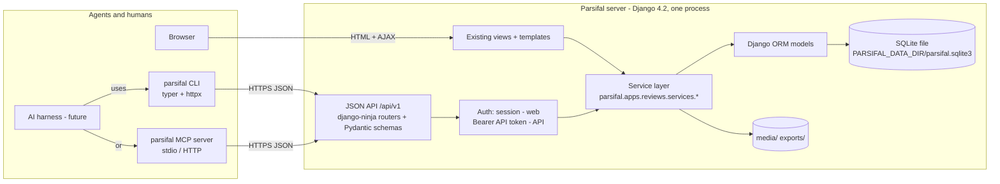

# 11 — System Design for the Fork

Target architecture for `parsifal-ai`. It is **additive**: the Django web
application described in [02-architecture.md](02-architecture.md) keeps
working; new components sit beside it and share the same models. Every new
component follows the conventions in §9 so that it looks like the existing
code.

## 1. Component view



One registry of **operations** (name, HTTP method, path, request/response
schema) drives the API routers, the CLI commands and the MCP tools, so the
three surfaces cannot diverge: a parity test asserts that every operation in
the server's OpenAPI document has a CLI command and an MCP tool.

## 2. Storage: SQLite and the data directory (ADR-001)

```python
# settings/base.py (sketch)
PARSIFAL_DATA_DIR = Path(config("PARSIFAL_DATA_DIR", default=BASE_DIR.parent / "data"))
DATABASES = {"default": dj_database_url.config(
    default=f"sqlite:///{PARSIFAL_DATA_DIR / 'parsifal.sqlite3'}", conn_max_age=600)}
MEDIA_ROOT = PARSIFAL_DATA_DIR / "media"
STATIC_ROOT = PARSIFAL_DATA_DIR / "static"
```

- `core/apps.py` connects `django.db.backends.signals.connection_created` to
  run `PRAGMA journal_mode=WAL; PRAGMA synchronous=NORMAL; PRAGMA busy_timeout=30000;
  PRAGMA foreign_keys=ON;` on SQLite connections (Django 4.2 has no
  `init_command` option for SQLite).
- Imports wrap batches of ~500 articles in `transaction.atomic()` to keep
  write locks short.
- Add missing uniqueness constraints via a migration
  (`QualityAssessment(article, question)`, `DataExtraction(article, field)`,
  `SearchSession(review, source)`), using `UniqueConstraint` with a
  condition for the nullable `source`.
- Backups: `parsifal backup` runs `sqlite3 .backup` (Python `sqlite3`
  `Connection.backup`) into `PARSIFAL_DATA_DIR/backups/`.
- Remove `psycopg2-binary`; CI runs without Postgres.

## 3. Service layer (implemented in phase 2)

Package `parsifal/apps/reviews/services/` (plain modules, no classes needed).
`_common.py` holds the shared helpers (`get_child`/`get_children` scoped
lookups raising `NotFound`, `check_length`, `require`, `reorder`):

| Module | Functions (examples) | Replaces logic in |
|--------|----------------------|-------------------|
| `agents.py` | `create_agent(review, actor, name)`, `new_token(review, actor, agent_id)`, `delete_agent(review, actor, agent_id)`, `list_agents`, `stats`, `jev_agent(review)` | `settings/views.py`, API |
| `accounts/services.py` | `get_jev`, `save_jev`, `test_jev`, `remove_jev` (the user's Jev key); `get_library_access`, `library_proxy_address`, `save_library_access`, `remove_library_access` (the user's library proxy; links built by `core/library_proxy.py`: `clean_host`, `proxied`, `label`) | `accounts/views.py` (Settings → Integrations, Settings → Library access), API |
| `ai_screening.py` | `default_context`, `exclusion_options`, `inclusion_options`, `criteria_options`, `clean_criteria` (the criteria chosen), `clean_phase`, `clean_statuses`, `scope_counts` (per source and status), `run_settings`, `starting_settings` (the last run's of the action, or the defaults), `start_run`, `process_step` (also continues an interrupted run), `unfinished_run`, `is_active`, `progress`; `preview`; `threshold_range`; builds the Jev request (`state`, `build_request`) and reads it (`combine`, `combine_inclusion`, `decide_inclusion` with the rule all/any); `relevance`, `with_relevance`, `article_relevance` (the AI column) | `conducting/views.py` (*Exclude/Include/Screen with AI*), `studies.list_articles`; calls `core/jev.py` |
| `ai_runs.py` | The control of the runs: `standing` (decisions still each run's), `latest_run`, `controls`, `undo_preview`, `undo_run` (the latest run only: restores what still stands, deletes the run), `rerun_settings`, `rerun`, `impact` (what a new run would rewrite) | `conducting/views.py` (*AI runs* window, *Start anyway*), `api/v1/routers/ai_screening.py` |
| `screening_requests.py` | The request template of each action: `default`, `clean` (what a reviewer may edit around the placeholders), `values`, `build` (state and questions for one study: the exclusion question, the inclusion questions, or both for screen), question ids | `ai_screening.py` |
| `selection.py` | `reset_summary`, `reset` (back to the start of study selection: studies but duplicates unclassified, chosen reviewers' decisions deleted, a run in progress discarded) | `settings/views.py` (Danger zone), API |
| `reviews.py` | `create_review(actor, title, description)`, `update_review(review, **fields)`, `rename_review(review, name)`, `transfer_review(review, actor, to_user)`, `delete_review(review)`, `leave` | `reviews/views.py`, `settings/views.py` |
| `protocol.py` | `set_objective`, `set_picoc`, questions CRUD + `reorder_questions(review, ids)`, keywords CRUD (+ synonyms), `import_picoc_keywords`, `generate_search_string(review) -> str`, `set_generic_search_string`, sources (`list_default_sources`, `attach_source`, `create_source`, `detach_source`), criteria CRUD | `planning/views.py` |
| `quality.py` | QA questions/answers CRUD + reorder, `add_suggested_answers`, `max_score`, `set_cutoff`, `assess(article, question, answer, actor)`, `article_score`, `summary(review)` | `planning/views.py`, `conducting/views.py` |
| `extraction.py` | fields CRUD (+ lookups sync, type-change wipe), `set_value(article, field, value, actor)` with **set semantics for select-many**, `mark_done`, `matrix(review)` | `planning/views.py`, `conducting/views.py`, `models.DataExtraction` |
| `search.py` | per-source search sessions: `add`, `set_string`, `copy_generic`, `remove`; Scopus proxy | `conducting/views.py` |
| `studies.py` | `import_bibtex(review, source, text|file, actor) -> ImportResult`, `create_article`, `update_article`, `delete_articles`, `set_status(review, ids, status, criteria=None, actor)`, `find_duplicates`, `resolve_duplicates`, `list_articles(filters, order: title or ai_score)` | `conducting/views.py` |
| `analytics.py` | `selection_by_source`, `final_selection_by_year` (+ later facet matrices) | `conducting/views.py` |
| `reports.py` | `build_docx(review, sections) -> bytes`, `articles_rows(review)`, `extraction_rows(review)` (shared by XLSX/CSV/JSON) | `reporting/export.py`, XLS exports |

Rules:

- Signature: keyword-only, first argument the already-authorised `review`
  (or `actor` for review-level ops). Services never read `request`.
- **Scoping:** children are always fetched with `review=review`; passing an
  id from another review raises `NotFound`.
- **Errors:** raise `parsifal.apps.core.exceptions.{DomainError, NotFound,
  PermissionDenied, Conflict, ValidationError}`; no bare `except Exception`.
- **Validation:** explicit length/choice checks instead of silent truncation;
  return warnings where truncation is legitimate (import).
- Views may be refactored to call services, one view at a time, each with a
  test; this is optional and never blocks the API work.

## 4. Authentication for agents (ADR-004) — implemented in phase 3

- Model `accounts.ApiToken(user, name, prefix, key_hash, created_at,
  last_used_at, revoked_at)`. Token string `pfl_` + 40 url-safe random chars;
  only SHA-256 stored; `prefix` (first 12 chars) shown in lists.
- Ninja auth class `BearerTokenAuth(HttpBearer)` → returns the `User`;
  `SessionAuth` kept so the browser can call the API too.
- Authorization: reuse `review.is_author_or_coauthor(user)` /
  `review.author == user` in a small helper `require_member(review, user)` /
  `require_owner`. Superusers may manage users and create reviews for others.
- Provisioning: `manage.py init` (creates DB, loads default sources, creates
  admin, prints a first token), `manage.py create_api_token --user --name`,
  UI page `/settings/tokens/` (list, create, revoke, delete once revoked).
- Clients read `PARSIFAL_URL` and `PARSIFAL_TOKEN` (env) or
  `~/.config/parsifal/config.toml` with named profiles.

## 5. JSON API (`parsifal/api/`) — implemented in phase 3 (see [14-api.md](14-api.md) for the final paths)

- New Django app `parsifal.api` with `api.py` (`NinjaAPI(title="Parsifal",
  version="1", urls_namespace="api-v1", auth=[BearerTokenAuth(), SessionAuth()])`),
  mounted at `/api/v1/`; OpenAPI at `/api/v1/openapi.json`, Swagger UI at
  `/api/v1/docs`.
- `parsifal/api/v1/routers/<resource>.py` and `parsifal/api/v1/schemas/<resource>.py`.
  Routers call services only. Exception handlers map domain errors to
  404/403/409/422 with `{"detail": ..., "code": ...}`.
- Conventions: snake_case JSON, integer ids, `limit`/`offset` pagination with
  `{"count", "items"}`, `PATCH` for partial updates, ISO-8601 timestamps,
  explicit `operation_id`s (`reviews_list`, `articles_set_status`, …) because
  they name CLI commands and MCP tools.

### Resource map (v1)

| Path | Ops | Notes |
|------|-----|-------|
| `/me` | GET | current user, tokens count |
| `/users` | GET/POST (superuser) | create co-author accounts without sign-up |
| `/tokens` | GET/POST/DELETE | own tokens |
| `/sources/defaults` | GET | the 7 default libraries |
| `/reviews` | GET (filter `author`, `name`, `q`), POST | |
| `/reviews/{id}` | GET, PATCH (title, description, objective, picoc fields, cutoff, review_type*), DELETE | GET returns an **overview** (counts per step, prerequisites) — agents need it |
| `/reviews/{id}/name` | PUT | rename slug |
| `/reviews/{id}/transfer` | POST | |
| `/reviews/{id}/members` | GET, POST (`username`/`email`), DELETE `/{user_id}` | direct add replaces e-mail invites for API users; invites remain in UI |
| `/reviews/{id}/questions` | GET, POST; `/{qid}` PATCH, DELETE; `/order` PUT | |
| `/reviews/{id}/keywords` | GET, POST (with `synonyms[]`, `related_to`); `/{kid}` PATCH, DELETE; `/import-picoc` POST | |
| `/reviews/{id}/search-string` | GET, PUT; `/generate` POST → string | generic |
| `/reviews/{id}/sources` | GET, POST (`source_id` or `{name,url}`); `/{sid}` DELETE | |
| `/reviews/{id}/sources/{sid}/search-string` | GET, PUT, DELETE; `/copy-generic` POST | |
| `/reviews/{id}/criteria` | GET, POST (`type` I/E); `/{cid}` DELETE | |
| `/reviews/{id}/quality/questions`, `/quality/answers` | CRUD + `/order`; `/quality/answers/suggested` POST; `/quality/max-score` GET; `/quality/cutoff` PUT | |
| `/reviews/{id}/extraction/fields` | CRUD (+ `lookup_values[]`) + `/order` | |
| `/reviews/{id}/articles` | GET (filters: `source`, `status`, `q`, `finished`, pagination), POST | |
| `/reviews/{id}/articles/{aid}` | GET, PATCH, DELETE | |
| `/reviews/{id}/articles/status` | POST `{ids[], status, criteria_id?, comments?}` | bulk |
| `/reviews/{id}/articles/import` | POST JSON `{source_id, bibtex}` or multipart | returns `{imported, failed, warnings[]}` |
| `/reviews/{id}/articles/duplicates` | GET; `/resolve` POST (`all` or `ids[]`) | |
| `/reviews/{id}/articles/{aid}/quality` | GET, PUT `{question_id, answer_id}` | records `user` |
| `/reviews/{id}/articles/{aid}/extraction` | GET, PUT `{field_id, value | values[]}`; `/done` PUT | set semantics |
| `/reviews/{id}/quality/summary` | GET | |
| `/reviews/{id}/analytics/selection-by-source`, `/analytics/final-by-year` | GET | JSON instead of text |
| `/reviews/{id}/export/articles.{csv,xlsx,json}`, `/export/extraction.{csv,xlsx,json}`, `/export/report.docx?sections=` | GET | |
| `/library/documents`, `/library/folders` | CRUD, import | v1.1 |
| `*` reserved for phase 7–8 | `/reviews/{id}/facets`, `/articles/{aid}/classification`, `/decisions`, `/agreement`, `/test-set`, `/checklist` | see [10-methodology.md](10-methodology.md) |

## 6. CLI (`clients/parsifal-cli/`) — implemented in phase 4 (see [15-cli-and-mcp.md](15-cli-and-mcp.md))

- Separate installable package `parsifal-cli` (`pyproject.toml`,
  `requires-python >= 3.10`), dependencies `typer`, `httpx`, `rich`,
  `pydantic`. Lives in the same repository under `clients/` so docs, tests
  and releases stay together; it never imports Django.
- Command tree mirrors resources: `parsifal review list|create|get|update|delete|rename|transfer`,
  `parsifal member …`, `parsifal question …`, `parsifal keyword …`,
  `parsifal search-string …`, `parsifal source …`, `parsifal criteria …`,
  `parsifal quality question|answer|assess|summary …`,
  `parsifal extraction field|set|done|matrix …`,
  `parsifal article list|get|create|update|delete|status|import|duplicates …`,
  `parsifal analytics …`, `parsifal export …`, `parsifal token …`,
  `parsifal config …`.
- Output: JSON by default when stdout is not a TTY (agents), tables when it is;
  `--json` / `--table` flags; non-zero exit codes map from HTTP errors;
  `--review` accepts an id **or** `username/slug`.
- Input: options for scalar fields; `--from-file path|-` for BibTeX and long
  text; `--yes` for destructive commands.
- Operation registry `parsifal_cli/operations.py`: a list of dataclasses
  `(operation_id, method, path, params, body_schema, summary)` hand-written
  from the API; a test downloads `/api/v1/openapi.json` from a live test
  server and fails on any operation missing or mismatched.
- `parsifal docs` prints a condensed workflow guide (planning → conducting →
  reporting) for agents.

## 7. MCP server (`clients/parsifal-cli/parsifal_mcp/`) — implemented in phase 5

- Same package; entry point `parsifal-mcp`; built with the official `mcp`
  Python SDK (`FastMCP`). Transports: **stdio** (default; what
  `claude mcp add parsifal -- parsifal-mcp` and Codex use) and streamable
  HTTP (`parsifal-mcp --http :8765`) for remote agents.
- Tools are generated from the same operation registry:
  `parsifal_<resource>_<action>` (e.g. `parsifal_articles_set_status`), with
  Pydantic input models and JSON results. Destructive tools carry
  `annotations.destructiveHint=true`.
- A few composite tools reduce round-trips for agents:
  `parsifal_review_overview` (protocol + counts + next steps),
  `parsifal_articles_screen_batch` (page of unclassified articles with
  title/abstract/keywords), `parsifal_workflow_guide` (static text from
  `doc/04-review-workflow.md`).
- Resources: `parsifal://reviews/{id}/protocol` (Markdown rendering) for
  context loading.
- Configuration via `PARSIFAL_URL` / `PARSIFAL_TOKEN`; the server never
  touches the database directly.

## 8. Packaging and running (self-hosted)

- `Dockerfile` (python:3.10-slim, gunicorn, whitenoise for static) and
  `docker-compose.yml` with one service and a `./data` volume.
- `make run` / `make init` targets; `.env.example` rewritten for self-hosting
  (`SECRET_KEY` generated by `init`, `DEBUG=False`, `ALLOWED_HOSTS`,
  `PARSIFAL_DATA_DIR`, `PARSIFAL_ALLOW_SIGNUP=False`, `ELSEVIER_API_KEY`).
- E-mail: `EMAIL_BACKEND` configurable; defaults to console (invites print
  the link to the log). Invites can also be fetched by the admin from the UI
  and shared manually.

## 9. Conventions for new code

| Topic | Rule (matches existing code) |
|-------|------------------------------|
| Layout | New Django apps under `parsifal/apps/<name>/` with `apps.py`, `models.py`, `urls.py`, `tests/`; API under `parsifal/api/`; clients under `clients/`. |
| Style | black (119), isort profile from `setup.cfg`, flake8; `make build` must pass; migrations excluded. |
| Naming | snake_case modules/functions, `CamelCase` models, `verbose_name` with `gettext_lazy`, choices as class constants (`Article.ACCEPTED = "A"`). |
| Settings | New values read with `config("NAME", default=…, cast=…)` in `base.py` under the existing banner comments; document them in [08-configuration-and-deployment.md](08-configuration-and-deployment.md). |
| Tests | `django.test.TestCase`, `factory_boy` factories in `tests/factories.py`, `setUpTestData`, `subTest`; one test module per router/service module; see [09-testing.md](09-testing.md). |
| Migrations | One migration per logical change; `makemigrations --check` in tox; constraints over application-level `get_or_create`. |
| Changelog | A towncrier fragment in `parsifal/newsfragments/` per PR (`<issue>.feature|bugfix|misc`). |
| Docs | Update the relevant `doc/*.md` in the same PR; `doc/06-http-endpoints.md` gains an "API" column as endpoints land. |
| Errors | Typed exceptions from services; API maps them; views show `messages`. |
| Security | No state-changing GET; every child lookup scoped by review; tokens hashed; `SECRET_KEY` never defaulted in production. |
| Compatibility | Server and client code require Python ≥ 3.10 (ADR-005). |

## 10. Alternatives considered

- **In-process CLI via management commands** — simplest, no auth, but agents
  must run on the host. Rejected (ADR-002); the service layer still makes it
  possible to add thin management-command wrappers later.
- **DRF instead of django-ninja** — mature, but no Pydantic schemas to share
  with the clients and a larger surface for a small API. Rejected.
- **Generating the CLI/MCP from OpenAPI at runtime** — less code, but
  worse ergonomics (option names, composite tools) and a harder dependency
  on a live server at startup. Rejected in favour of a hand-written registry
  verified by a parity test.
- **MCP only** — leaves non-MCP agents and shell scripts out. Rejected.
