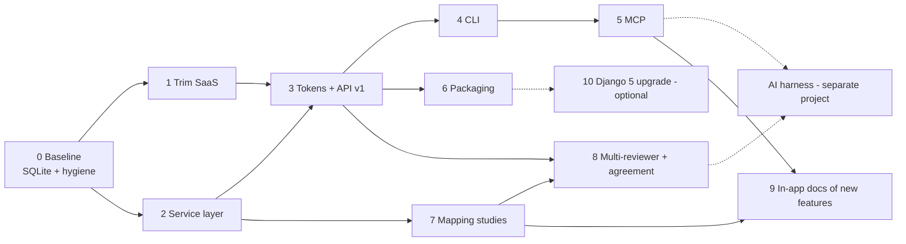

# 12 — Roadmap

Phased plan to reach the fork's goals ([01-overview.md](01-overview.md)).
Each phase lists deliverables, the tests that must exist, and acceptance
criteria. Sizes: S ≈ ≤1 day, M ≈ 2–4 days, L ≈ 1–2 weeks of focused work.
Phases 0–6 are the "agents can run a review end-to-end" track; 7–8 are the
methodology track; 9 documents the new features inside the site; 10 is
optional modernisation. The AI harness itself is out
of scope and consumes the result of phases 3–5 and 8.

## Phase 0 — Baseline: Python 3.10, SQLite default and hygiene (S) — ✅ done 2026-10-15

Deliverables
- Python minimum **3.10** (ADR-005): `pyproject.toml` `requires-python`,
  black target versions, tox env `py310`, CI matrix, README.
- `PARSIFAL_DATA_DIR`; `DATABASE_URL` default → SQLite in the data dir;
  `MEDIA_ROOT`/`STATIC_ROOT` under it; SQLite pragmas on
  `connection_created`.
- Remove `psycopg2-binary`; CI workflows without Postgres; `codecov.yml`
  targets `dev` too; tox `basepython = python3.10`.
- Fix bugs A1 (`Image.ANTIALIAS`), A2 (unauthenticated chart endpoints) from
  [13-known-issues.md](13-known-issues.md).
- `.env.example` rewritten for self-hosting; `README.md` "Running locally"
  updated.

Tests
- Migration-on-empty-SQLite test; picture upload/crop tests; auth tests for
  the two chart endpoints.

Acceptance
- `tox` green on a machine without Postgres; `manage.py runserver` works with
  no `.env`.

## Phase 1 — Trim SaaS / social features (M) — ADR-003 — ✅ done 2026-10-15

Outcome: `blog`, `help`, `activities` deleted (code and migrations; no other
app depended on them), `core.Media` dropped by `core.0003_delete_media`,
reCAPTCHA / Google Analytics / Sentry removed, `PARSIFAL_ALLOW_SIGNUP`
(default `False`) added, invites now offer any existing user, home page
reduced to the review list, cover page shows a login form when sign-up is
closed. Databases created by upstream keep orphan `blog_*`, `help_*`,
`activities_*` tables; drop them manually if migrating such a database.

Deliverables
- Remove apps `blog`, `activities`, `help`; remove `core.Media`,
  `utils/recaptcha.py`, GA and Sentry snippets/settings, `sentry-sdk`.
- `core.home`: review list only; `reviews.views.reviews`: no follower
  counts; `Profile`: drop follower helpers; `invites.SendInviteForm`:
  "contacts" field becomes a user picker (all users) or is removed in favour
  of e-mail/username; header/footer links updated; `about.html` rewritten.
- `PARSIFAL_ALLOW_SIGNUP` (default `False`): sign-up view returns 403 and the
  cover page shows login only. Invite links still allow account creation
  when the invite is pending.
- Migration strategy: a final migration in each removed app drops its tables,
  then the app is removed from `INSTALLED_APPS` and deleted; or reset all
  migrations (document the choice in the PR).

Tests
- Update/remove affected tests; add tests for `ALLOW_SIGNUP` on/off and
  invite-based sign-up.

Acceptance
- No references to removed apps (`grep` clean); templates render; test suite
  green.

## Phase 2 — Service layer and constraints (L) — ✅ done 2026-10-15

Outcome: `parsifal/apps/core/exceptions.py` (`DomainError`, `NotFound`,
`PermissionDenied`, `Conflict`, `ValidationError`) and
`parsifal/apps/reviews/services/` (`reviews`, `protocol`, `quality`,
`extraction`, `search`, `studies`, `analytics`, `reports`, `_common`).
Migration `0038` adds `Article.year_int` (kept in sync by `Article.save`) and
uniqueness constraints (`QualityAssessment(article, question)`,
`DataExtraction(article, field)`, `SearchSession(review, source)` + one
generic string per review) after de-duplicating existing rows. Conducting
views for import, bulk status, QA, data extraction, duplicates, charts and
XLS exports delegate to the services; planning views still contain their
logic (the API will call the services directly). 85 new tests (175 total),
services at 94 % line coverage. Found and fixed on the way: imported articles
never received their BibTeX key (bibtexparser exposes it as `ID`, upstream
read `id`).

Deliverables
- `parsifal/apps/core/exceptions.py`; `parsifal/apps/reviews/services/`
  modules per [11-system-design.md](11-system-design.md) §3, covering every
  behaviour in [06-http-endpoints.md](06-http-endpoints.md) §3–6.
- Migration adding uniqueness constraints (D4) and `Article.year_int`
  (A4) with a data migration.
- At least the conducting views for import, bulk status, QA and extraction
  refactored to call services (proves the layer; keeps UI behaviour).

Tests
- Unit tests per service module: final selection with/without checklist and
  cut-off; duplicate grouping and resolution; search-string generation;
  keyword import from PICOC; `set_value` coercions and select-many set
  semantics; BibTeX mapping incl. Scopus aliases and truncation warnings;
  reorder; scoping errors (child of another review → `NotFound`).
- Golden `.bib` samples under `reviews/tests/data/`.

Acceptance
- ≥ 90 % coverage on `services/`; existing UI tests still pass.

## Phase 3 — API tokens and JSON API v1 (L) — ADR-002/004 — ✅ done 2026-10-15

Outcome: `accounts.ApiToken` (hashed, shown once; UI at `/settings/tokens/`,
admin read-only), `BearerTokenAuth` + session auth, `parsifal.api` with 81
operations under `/api/v1/` (Swagger at `/api/v1/docs`), typed error mapping
(404/403/409/422), exports as CSV/XLSX/JSON/DOCX, management commands
`init`, `create_api_token`, `load_default_sources`. 42 new tests (217 total),
API package at 98 % line coverage, including the end-to-end scenario
`parsifal/api/tests/test_e2e_full_review.py`. Reference: [14-api.md](14-api.md).

Deliverables
- `accounts.ApiToken` + migration; `BearerTokenAuth`; `/settings/tokens/`
  page; management commands `init`, `create_api_token`,
  `load_default_sources`.
- `parsifal.api` app with routers/schemas for the resource map in
  [11-system-design.md](11-system-design.md) §5 (everything except
  `library` and the reserved phase 7–8 resources); error handlers; OpenAPI
  with stable `operation_id`s; Swagger UI.
- Exports as CSV/XLSX/JSON (`openpyxl` replaces `xlwt`) and DOCX via the API.
- `doc/14-api.md` (generated summary + examples) added.

Tests
- One test module per router: auth required; member vs non-member (403/404);
  owner-only ops; happy paths; validation errors; pagination; import result
  shape. Token tests (hashing, revocation, last-used). Schema snapshot test
  for `openapi.json`.

Acceptance
- A scripted end-to-end run (`tests/e2e/test_full_review_api.py`) creates a
  review, builds a protocol, imports a `.bib`, screens, assesses, extracts and
  downloads the DOCX using only the API.

## Phase 4 — CLI (M) — ✅ done 2026-10-15

Outcome: `clients/parsifal-cli/` (package `parsifal-cli`, Python ≥ 3.10,
typer + httpx + rich). `parsifal_cli/operations.py` is the registry (81
operations); `cli.py` generates the command tree from it; `config.py`
handles flags/env/profiles; `client.py` resolves `author/slug` references,
pages with `--all`, maps HTTP errors to exit codes. 21 pytest tests in the
package plus the server-side parity test (`test_cli_parity.py`) and the
live-server e2e (`test_cli_e2e.py`). Reference: [15-cli-and-mcp.md](15-cli-and-mcp.md).

Deliverables
- `clients/parsifal-cli/` package (`parsifal` entry point), operation
  registry, config profiles, JSON/table output, `--review user/slug`
  resolution, `parsifal docs`.
- `doc/15-cli-and-mcp.md` with agent-oriented examples (how Claude Code /
  Codex should drive a review).

Tests
- `CliRunner` tests per command group with mocked HTTP; parity test against
  the server's OpenAPI (run with `LiveServerTestCase`); one real end-to-end
  run mirroring phase 3's script through the CLI.

Acceptance
- Every API operation reachable from the CLI; `parsifal --help` lists them.

## Phase 5 — MCP server (M) — ✅ done 2026-10-15

Outcome: `parsifal_mcp/server.py` generates 81 tools from the registry plus
`parsifal_articles_screen_batch`, `parsifal_review_protocol` (also a
`parsifal://reviews/{id}/protocol` resource) and `parsifal_workflow_guide`;
stdio and streamable-HTTP transports; tool annotations (read-only /
destructive / idempotent). 10 pytest tests (31 in the package). Reference:
[15-cli-and-mcp.md](15-cli-and-mcp.md).

Deliverables
- `parsifal-mcp` entry point (stdio + HTTP) generated from the registry;
  composite tools (`review_overview`, `articles_screen_batch`,
  `workflow_guide`); protocol resource; destructive-tool annotations.
- Install instructions for Claude Code (`claude mcp add parsifal -- parsifal-mcp`),
  Codex and generic HTTP clients.

Tests
- Tool-schema snapshot; in-process tool invocation with mocked API; parity
  test (every CLI command ↔ MCP tool).

Acceptance
- A Claude Code session with the MCP configured can perform the phase 3
  end-to-end script using tools only.

## Phase 6 — Packaging for self-hosting (S/M) — ✅ done 2026-10-15

Outcome: `Dockerfile` (python:3.10-slim, gunicorn, static collected at build),
`bin/entrypoint.sh` (`serve` | `init` | `manage`), `docker-compose.yml` with a
`./data` volume, WhiteNoise for static files, Django-served `/media/`,
production settings that work without SMTP and with a `PARSIFAL_HTTPS`
switch, `manage.py backup`/`restore` (SQLite online backup API), Makefile
targets, a CI job that builds the image, runs `init` and calls the API.
Reference: [16-self-hosting.md](16-self-hosting.md).

Deliverables
- `Dockerfile`, `docker-compose.yml` (single service, `./data` volume),
  whitenoise, `make run|init|backup`, `parsifal backup`/`restore`
  commands; `doc/16-self-hosting.md`.

Tests
- Smoke test in CI: build image, run `init`, hit `/api/v1/me` with the
  printed token.

Acceptance
- `docker compose up` on a clean machine yields a working instance with an
  admin and a token in under two minutes.

## Phase 7 — Systematic mapping study support (L) — ADR-006 — ✅ done 2026-10-15 (API first; UI minimal)

Outcome (migration `reviews.0039_mapping_studies`): `Review.review_type`
(`slr` | `mapping`, selectable on creation and in review settings, badge in
the review header), `selection_procedure` / `synthesis_strategy` /
`validity_threats`; `SearchSession.search_type/searched_at/years_from/years_to/result_count`
and `Article.found_via` provenance (set on import); `ClassificationFacet`
(fixed/emerging, single or multiple, templates research_type /
contribution_type / research_method / venue_type / study_focus),
`ClassificationCategory`, `ArticleClassification` (set semantics, attributed
to the acting user); `ReviewTestSetArticle` with DOI/title matching and
recall; `ProcessChecklistItem` with the 26 actions of Petersen Table 8.
Services `classification.py` and `mapping.py`; analytics `facet_frequencies`
and `facet_matrix` (bubble-plot data); DOCX report with filled QA / extraction
/ analysis sections and new sections (classification scheme and results,
procedures, validity threats, search documentation, test set, process
checklist). API: 22 new operations (103 total), CLI groups `facet`,
`facet category`, `classification`, `test-set`, `checklist`, `source
document-search`; MCP tools follow. The web UI only exposes the review type;
facet/classification pages are deferred to the in-app docs phase or later.

Deliverables (from [10-methodology.md](10-methodology.md) §4)
- `Review.review_type`, `validity_threats`, `selection_procedure`,
  `synthesis_strategy`; `SearchSession.search_type/searched_at/years/result_count`;
  `Article.found_via`.
- `ClassificationFacet`, `ClassificationCategory`, `ArticleClassification`
  with templates (research type, contribution type, research method, venue
  type, study focus); keywording notes; `ReviewTestSetArticle`;
  `ProcessChecklistItem` with Petersen §5.4 rubric items.
- QA optional when `review_type = mapping` (prerequisite messages and final
  selection ignore the cut-off); analytics: facet frequencies and
  facet × facet matrix; DOCX template for maps (P §5.3) and filled QA /
  extraction / analysis sections for SLRs.
- UI: minimal pages for facets/classification (reuse planning/conducting
  patterns) — API first, UI can lag.
- API: `/facets`, `/articles/{aid}/classification`, `/test-set`,
  `/checklist`, `/analytics/facet-matrix`; CLI/MCP regenerated.

Tests
- Service + API tests for every new entity; final-selection behaviour per
  review type; matrix aggregation; DOCX content assertions.

Acceptance
- A mapping study can be planned, classified and reported end-to-end via the
  API with bubble-plot data available as JSON.

## Phase 8 — Multi-reviewer decisions and agreement (M/L) — ✅ done 2026-10-15

Outcome (migration `reviews.0040_study_decisions`): `StudyDecision(review,
article, user, stage title_abstract|full_text, status, criteria, comments)`
unique per (article, user, stage); the unused `SearchResult`,
`StudySelection` and `Study` models were dropped. `services/decisions.py`:
record/remove/list decisions, Cohen's kappa with Landis & Koch labels,
disagreements, consolidation rules `unanimous` / `any_include` / `majority`
(sets `Article.status`, attributed to the actor), summary in the review
overview. API `decisions_*` (8 operations, 111 total) and CLI group
`decision`; MCP tools follow. Quality assessments, extractions and
classifications already record the acting user since phases 2 and 7. The
"AI reviewer" scenario is covered by `parsifal/api/tests/test_decisions.py`.

Deliverables
- `StudyDecision(review, article, user, stage, status, criteria, comments)`
  replacing the unused `StudySelection`/`Study`/`SearchResult` (drop them);
  `Article.status` remains the consolidated decision.
- Services: record decision, consolidate with decision rules (unanimous /
  any-include / owner decides), Cohen's Kappa per stage and per pair of
  reviewers, list disagreements; populate `user`/timestamps on
  `QualityAssessment`, `DataExtraction`, `ArticleClassification`.
- API/CLI/MCP: `/decisions`, `/agreement`, `/disagreements`, `/consolidate`.

Tests
- Kappa against known examples; decision rules; per-user isolation; the
  "AI reviewer" scenario: a token user records decisions, a human consolidates.

Acceptance
- Two users (one human, one agent token) screen the same set independently;
  the system reports agreement and produces a consolidated selection.

## Phase 9 — In-app documentation of the new features (M) — ✅ done 2026-10-15

Outcome: app `parsifal.apps.docs` serving `/docs/` from Markdown files in
`parsifal/apps/docs/content/` (rendered with `Markdown`, cached unless
`DEBUG`), inside the site layout (masthead, left navigation grouped by
section, Bootstrap 3 panels). Nine pages: what is new, self-hosting, API
tokens, JSON API, CLI, MCP server, working with AI agents, systematic mapping
studies, multiple reviewers and agreement. Header and footer link to it (the
footer now points to this fork's repository). Tests render every page for
anonymous and authenticated users, check content/registry parity, 404s and
that every internal `/docs/` link resolves.

The upstream `help` app (a CMS) is removed in phase 1. This phase brings
documentation **back into the site**, as static pages that follow the existing
Bootstrap 3 design, covering only what the fork adds: self-hosting and
`init`, API tokens, the JSON API, the CLI, the MCP server, mapping-study
support (facets, classification, bubble plots), multi-reviewer decisions and
agreement, and how an AI agent is expected to drive a review. The inherited
SLR workflow is not re-documented here (the UI is self-explanatory and
`doc/04-review-workflow.md` exists).

Deliverables
- A `docs` section (Django app `parsifal.apps.docs` or templates under
  `core`) served at `/docs/`, linked from the header and footer, with a left
  navigation, one template per topic and code samples (curl, CLI, MCP
  config).
- Content kept as Markdown files in the repo (`parsifal/apps/docs/content/*.md`)
  rendered server-side at request time with a small Markdown library, so the
  same source can be reused by `parsifal docs` (CLI) and the MCP
  `workflow_guide` tool.
- A "What's new vs. upstream Parsifal" page.
- Styling: reuse `parsifal.css`, `base.html` blocks and the existing menu
  patterns (`settings/includes/menu.html`) so the pages look native.

Tests
- Every docs page renders (200) anonymously and authenticated; Markdown
  files all have a route; link checker over the rendered pages.

Acceptance
- A new user can set up an instance, create a token and run the CLI/MCP by
  following only the in-app docs.

## Phase 10 — Optional modernisation

- Django 5.x (and Python 3.12 as a configuration change); `bibtexparser`
  2.x; replace jQuery AJAX GET mutations with POST; squash migrations; port
  `code-rag` to `sqlite-vec` (separate repository) if the team wants a
  single-database toolchain.

## Definition of done (every phase)

1. `make build` and `tox` pass; new code ≥ 90 % covered.
2. Towncrier fragment added; relevant `doc/*.md` updated in the same PR.
3. No new state-changing GET, no unscoped child lookup, no bare
   `except Exception` in new code.
4. Behaviour reachable from UI (where applicable), API, CLI and MCP with
   parity tests green.

## What the AI harness will rely on

- A token-authenticated API/CLI/MCP covering the full workflow (phases 3–5).
- Per-user decisions, assessments, extractions and classifications so the
  agent's work is attributable and reviewable (phase 8).
- Machine-readable protocol (`review_overview`), batch screening payloads
  (title, abstract, keywords, criteria), and JSON analytics/exports.
- The indexed guidelines (`kitchenham-2007`, `petersen-2015`) and this
  documentation as grounding material.

## Trimming round — ✅ 2026-10-16 (ADR-008)

Removed e-mail invites (→ Manage access by username), ownership transfer,
Scopus/Elsevier search, profile pictures and public profiles, the
'Published reviews' panel and the pt-br placeholder. Kept the library,
sitemaps/About/Support and password reset. Also added: review type column in
the review lists, the Reviewers tab and Reviewer agreement panel on the study
selection page, and the single-workflow framing of the docs.

Follow-up (2026-10-16): after a browser QA round, `manage.py init` refuses
reserved usernames (`admin` collided with `/admin/`), and the two gaps between
the web UI and the API/CLI/MCP were closed — the personal library
(`/library/…`, 14 operations) and `PATCH /me`. Every feature reachable in the
browser now has an API operation (sign-up, login and password reset excepted).
